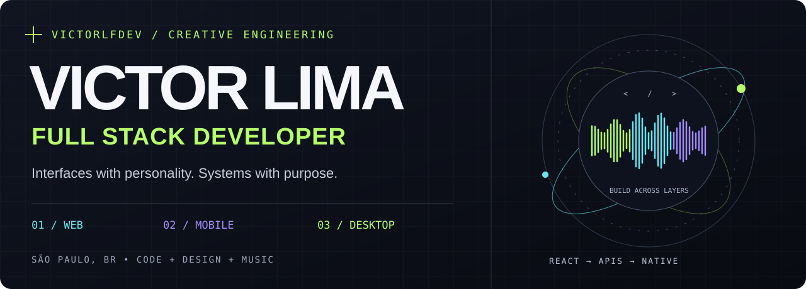
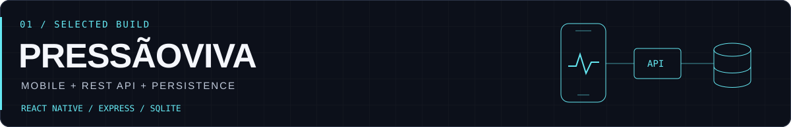
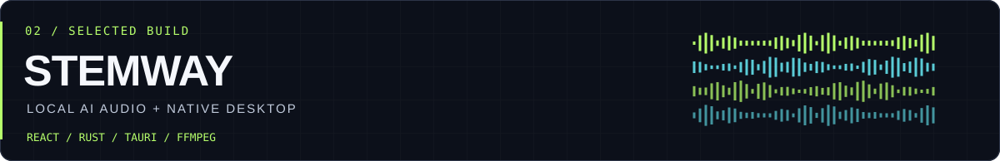
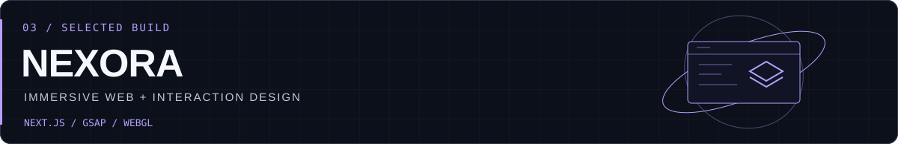

# Full Stack Developer · Creative Technologist

**From expressive interfaces to APIs, mobile apps, and native desktop tools.**

  

  

[About](#-behind-the-code) · [Projects](#-selected-builds) · [Stack](#-my-toolbox) · [Activity](#-github-signal)

## 👾 Behind the code

I'm **Victor Lima**, a developer and musician based in **São Paulo, Brazil**. I build across the stack, connecting expressive interfaces with the application logic, APIs, and data behind them.

My recent work spans **offline-first mobile apps**, **REST APIs**, **native desktop software**, and **interactive websites**. UI design and motion remain a big part of how I approach software: the experience matters as much as what happens behind it.

🎛️ **Current interests:** local AI audio processing, React Native, Rust/Tauri, and motion on the web.  
🎸 **Outside the editor:** music and gaming.

| 🎨 Experience | ⚙️ Application | 🎧 Native & audio |
| :--- | :--- | :--- |
| Responsive interfaces, visual identity, GSAP, and WebGL | Node.js APIs, data persistence, offline sync, and containerized services | React + Rust/Tauri, audio playback, and AI model integration |

## 🚀 Selected builds

### 01 / PressãoViva — Mobile + API

A home blood pressure tracking project with a **React Native / Expo app**, an **Express REST API**, and **SQLite persistence**. Includes offline recording and synchronization, trend charts, reminders, and gamification.

**Across the stack:** mobile interface → local storage and sync → REST endpoints → server database → Docker Compose.

     

[**Explore the repository ↗**](https://github.com/victorlfdev/arterial-monitor)

### 02 / Stemway — Desktop + AI audio

A desktop application for separating music into individual stems with **local AI processing**. A React interface connects to a **Rust / Tauri backend** that coordinates audio engines, file processing, and playback.

**Where music meets engineering:** model integration, FFmpeg workflows, stem preview, and export — with inference running on the user's machine.

   

[**Explore the repository ↗**](https://github.com/victorlfdev/Stemway)

### 03 / NEXORA — Web + creative development

A **portfolio concept for a fictional software house**, built with Next.js, GSAP, Lenis, and WebGL. Explores scroll choreography, dark-to-light transitions, and interactive storytelling, with responsive layouts and reduced-motion fallbacks.

**The visual side of the stack:** server-rendered content, optional WebGL effects, keyboard navigation, and browser accessibility checks. Showcased case studies and metrics are illustrative.

    

[**Explore the repository ↗**](https://github.com/victorlfdev/nexora) · [**Live experience ↗**](https://nexora-sable-theta.vercel.app)

<strong>🗂️ More from my workbench</strong>

 

| Project | Focus | Technologies |
| :--- | :--- | :--- |
| [Amplifica](https://github.com/victorlfdev/amplifica-landing) | Audiovisual brand landing page | Next.js, TypeScript, Framer Motion |
| [Salão Beauty](https://github.com/victorlfdev/salao-beauty) | Editorial design for a salon website | Next.js, Tailwind CSS, GSAP |
| [Koala & Co](https://github.com/victorlfdev/koalaco) | Brand presentation and scroll interactions | Next.js, GSAP, Lenis |
| [EducaOnline](https://github.com/victorlfdev/Hackathon) | Team project for a virtual science lab, FIAP Hackathon | React, TypeScript, Vite |

## 🧰 My toolbox

### Web & mobile

      

### Back-end & native

     

### Design, motion & quality

      

## 📡 GitHub signal

 

### Build something useful. Make it feel great.

**Web · Mobile · Desktop · Music**

[Let's talk on LinkedIn](https://www.linkedin.com/in/victor-lima-fernandes/) · [victorlf2002@gmail.com](mailto:victorlf2002@gmail.com)

